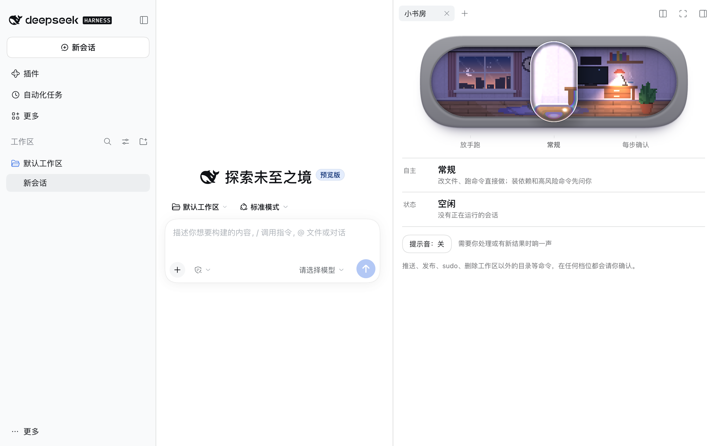
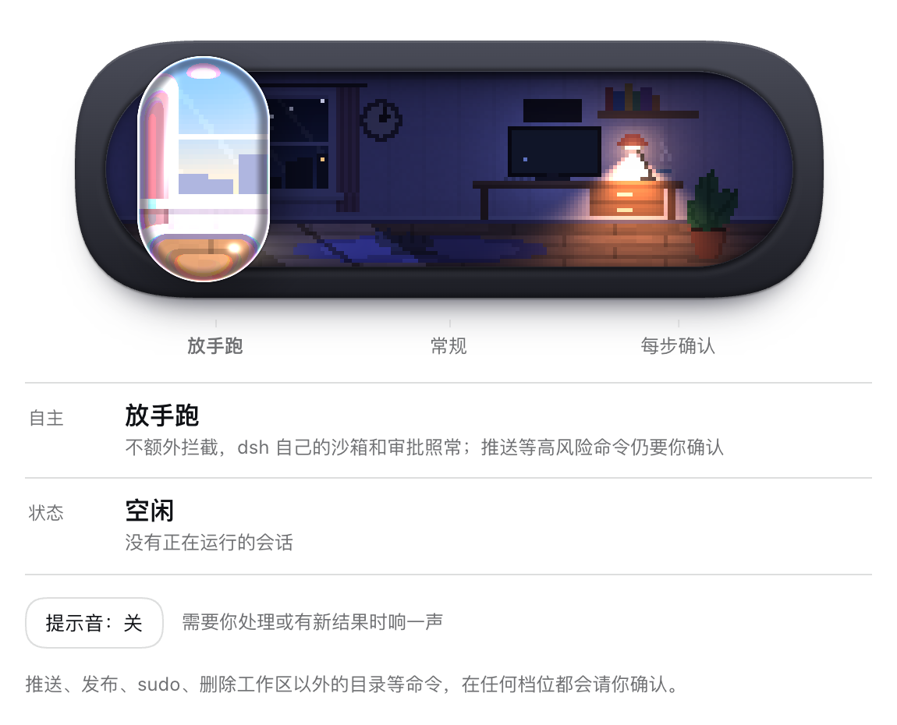
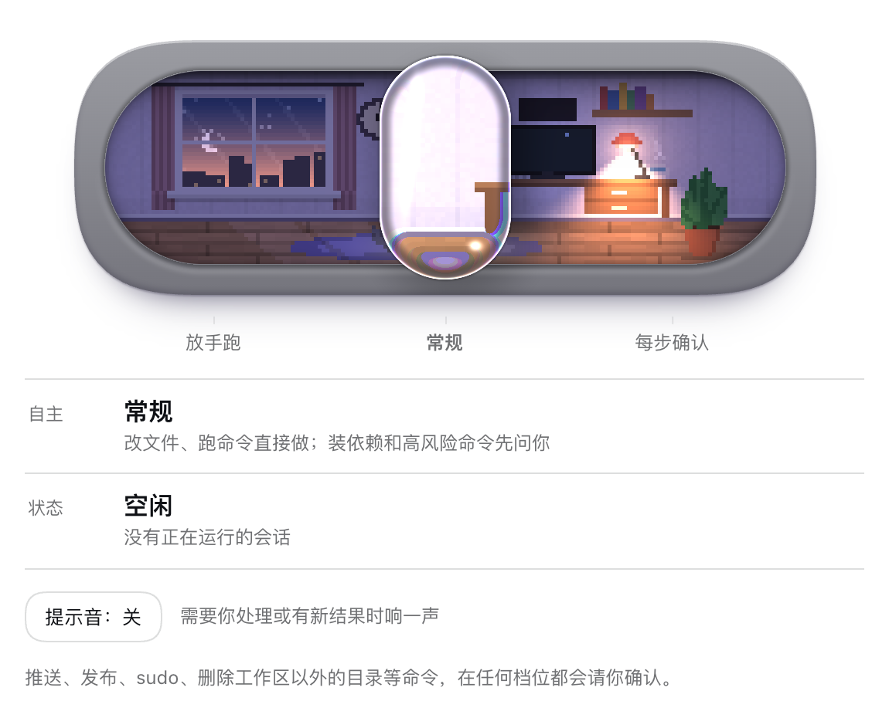
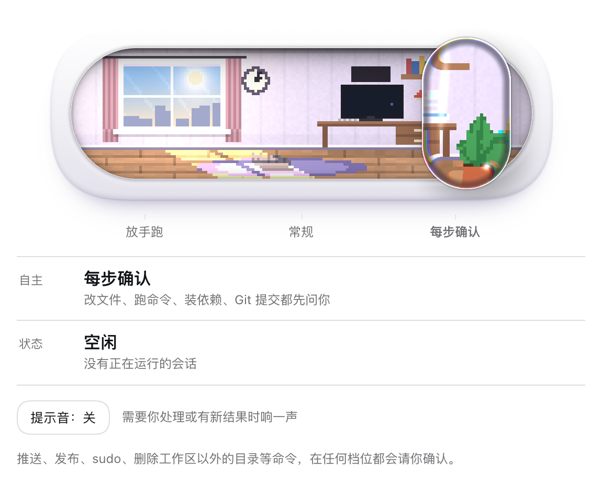

# dsh-workroom

English | [中文](README.md)

A right-sidebar plugin for DeepSeek Harness (`dsh`): a three-level **agent autonomy switch**, and a pixel room that shows what your sessions are doing.

- **The switch sets how much the agent decides alone.** Day ("Ask every step") asks before edits and commands; dusk ("Normal") asks before installs; night ("Hands-off") adds no prompts. High-risk commands such as push, publish and `sudo` ask you in every level.
- **The room shows session state.** A monitor typing code means a session is running; an amber sign, a cat sitting up and a pulsing ring around the switch mean a session is waiting for you; green means new results; red means the last turn failed. An optional chime sounds when you are needed.



Screenshots show the Chinese UI; the plugin also ships English labels.

## Levels

| Level | Room | Extra approval prompts for |
|---|---|---|
| Hands-off | night | high-risk commands only |
| Normal (default) | dusk | installing dependencies or downloading code; high-risk commands |
| Ask every step | day | changing files, running commands, installs, local Git history changes, high-risk commands, other unclassified tools |

| Hands-off | Normal | Ask every step |
|---|---|---|
|  |  |  |

Read-only tools (`read`, `grep`, `glob`, `web_fetch`, …) are never stopped.

**The plugin only ever adds prompts.** Each tool call first goes through dsh's own rules (sandbox, approval policy, other plugins); only a call that would be allowed outright can be turned into an approval prompt. Anything dsh would already ask about or deny stays that way. "Hands-off" is therefore dsh's default behaviour plus a mandatory prompt for high-risk commands.

## Classification

Based on the tool name and the shell command text:

- **High-risk** (every level): `git push`, `npm/pnpm/yarn/bun publish`, `git reset --hard`, `git clean -f`, `git branch -D`, `rm -r` of paths starting with `/`, `~`, `$HOME` or `..`, `sudo`, `curl … | sh`, `chmod 777`, `mkfs`, `dd if=`, `shutdown/reboot`, `docker push`, `kubectl apply/delete…`, `terraform apply/destroy`, `gh pr merge / release create / repo delete…`, plus your own patterns.
- **Install or download code**: `npm/pnpm/yarn/bun install|add|ci|update`, `npx`, `pnpm dlx`, `pip install`, `uv add`, `poetry add`, `cargo add/install`, `go get/install`, `brew install`, `apt install`, `gem install`, `composer require`, …
- **Local Git history**: `git commit/merge/rebase/cherry-pick/revert/tag/stash`, `git checkout -b`, creating branches.
- **Changing files**: `write`, `edit`, `apply_patch` and similar tools.
- Any other shell command counts as running a command.

Classification matches command text. It reduces interruptions; it is **not a security boundary** — a script that runs `git push` internally is not seen. Isolation still comes from the dsh sandbox.

## Install

Requires dsh 0.2.0 or later; tested on 0.2.2-rc.1. The switch and room appear in the Web UI (the `web` profile, including Desktop).

```bash
dsh plugin --profile web add github:qinghuidaqzp/dsh-workroom
```

Restart dsh, then open **Workroom** from the right sidebar's guide page.

The level is stored in the profile config (this row's `level` field), survives restarts, and is shared by all sessions.

## Configuration

```yaml
- id: workroom
  config:
    level: normal              # away | normal | present; normally set from the switch
    extraDangerCommands:       # extra high-risk regular expressions, asked in every level
      - 'make\s+deploy'
```

| Key | Default | Meaning |
|---|---|---|
| `level` | treated as `normal` when unset | current level, written by the switch |
| `extraDangerCommands` | `[]` | extra high-risk command patterns |
| `shellTools` | `bash, pwsh, shell, powershell, terminal, run_code` | tools whose `command` argument is a shell command |
| `writeTools` | `write, edit, apply_patch, …` | tools treated as changing files |
| `readTools` | `read, grep, glob, web_fetch, …` | read-only tools, never stopped |

## Limits

- Where there is no approval UI (`dsh headless` one-shot tasks, CI), dsh turns an approval prompt into a denial. Do not install the plugin in those profiles, or set `level` to `away`; high-risk commands are still denied there.
- The room shows an aggregate of all sessions: one session waiting for you is enough to show "Needs you".
- Browsers only play the chime after you have interacted with the page once.

## Development

```bash
npm test
```

The integration test drives the real dsh tool pipeline: put this repository at `node_modules/dsh-workroom` in a directory where `@deepseek-ai/dsh` is installed, then run `node node_modules/dsh-workroom/test/integration/policy.mjs`.

## License

MIT
