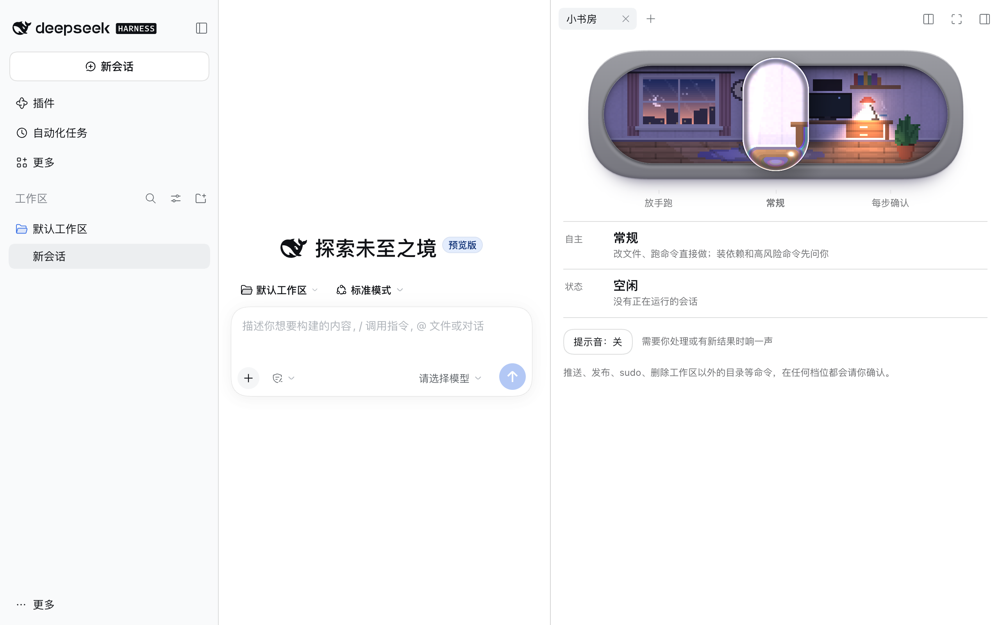
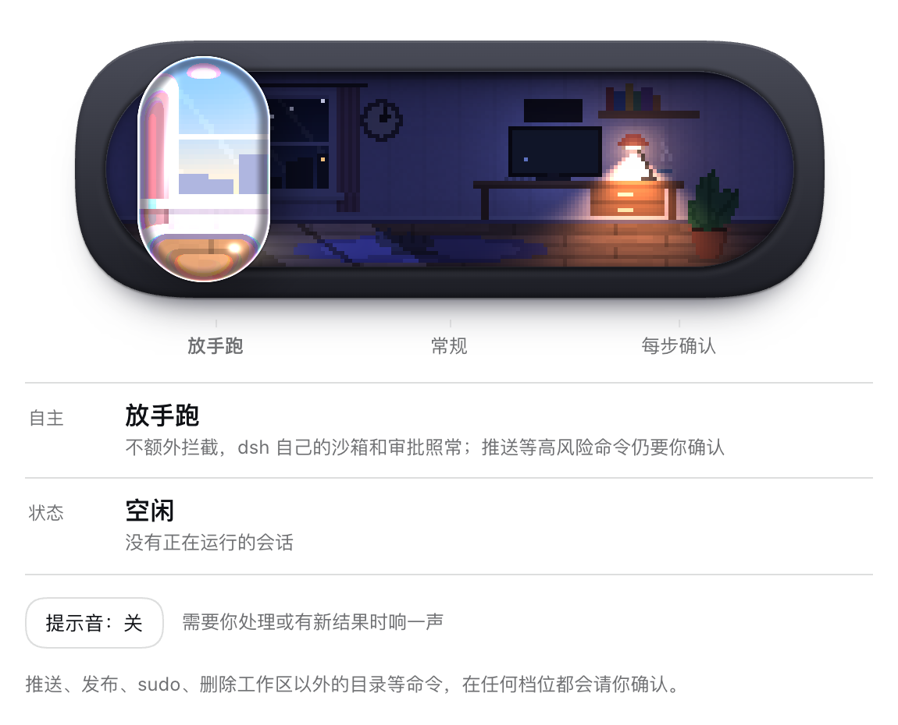
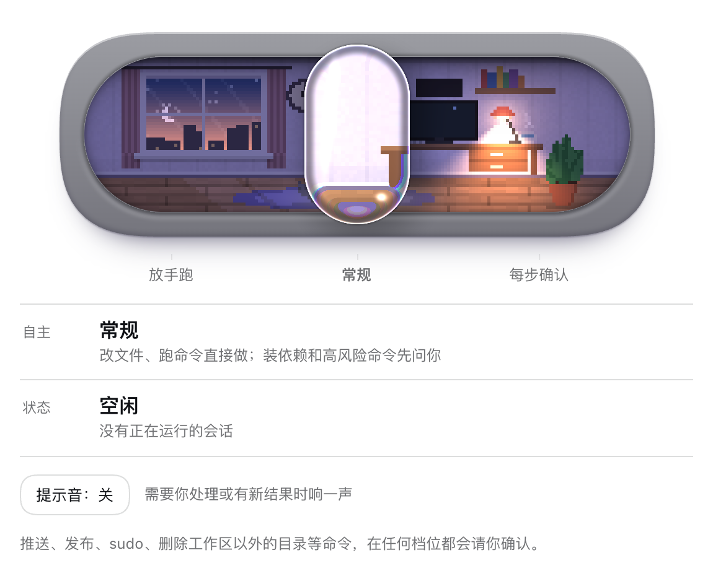
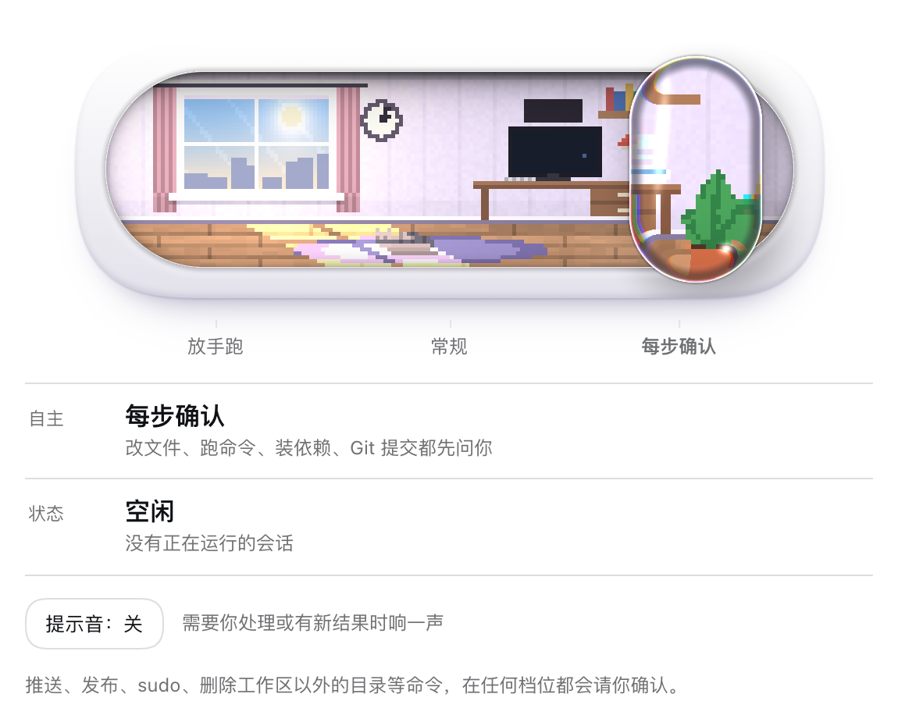

# dsh-workroom · 小书房

[English](README.en.md) | 中文

DeepSeek Harness（`dsh`）右侧栏里一间**会看 Agent 脸色的像素小书房**。

- **房间替你盯着会话。** 显示器在敲代码，说明有会话在跑；墙上灯牌闪黄、猫坐起来、旋钮外圈发光，说明有会话在等你确认；亮绿灯打对勾，是跑完了有新结果；变红，是上一轮出错了。可以打开提示音，需要你的时候响一声。不用一直切回对话看进度，瞄一眼房间就知道。
- **旋钮拨的是"放不放心"。** 拨到白天是"每步确认"，改文件、跑命令都先问你；黄昏是"常规"，只在装依赖时问；深夜是"放手跑"，不额外打扰你。推送、发布、`sudo` 这类高风险命令，任何一档都要你确认。



## 三个档位

| 档位 | 房间 | 会额外请你确认的操作 |
|---|---|---|
| 放手跑 | 深夜 | 只有高风险命令 |
| 常规（默认） | 黄昏 | 安装依赖或下载代码、高风险命令 |
| 每步确认 | 白天 | 修改文件、运行命令、安装依赖、改动本地 Git 历史、高风险命令、其他未归类的工具 |

| 放手跑 | 常规 | 每步确认 |
|---|---|---|
|  |  |  |

读取类工具（`read`、`grep`、`glob`、`web_fetch` 等）在任何档位都不会被拦。

**这个插件只会"多问"，不会"少问"。** 每次工具调用先交给 dsh 自己的规则（沙箱、审批策略、其他插件）判断，只有原本会直接放行的调用，才可能按档位改成"请你确认"。dsh 本来就要问你或拒绝的操作，插件不会放行。所以"放手跑"等于 dsh 的默认行为，再加上对高风险命令的强制确认。

## 命令怎么归类

插件看工具名和 shell 命令的文本：

- **高风险**（任何档位都问）：`git push`、`npm/pnpm/yarn/bun publish`、`git reset --hard`、`git clean -f`、`git branch -D`、对 `/`、`~`、`$HOME`、`..` 开头路径的 `rm -r`、`sudo`、`curl … | sh`、`chmod 777`、`mkfs`、`dd if=`、`shutdown/reboot`、`docker push`、`kubectl apply/delete…`、`terraform apply/destroy`、`gh pr merge / release create / repo delete…`，以及你在配置里加的正则。
- **安装依赖或下载代码**：`npm/pnpm/yarn/bun install|add|ci|update`、`npx`、`pnpm dlx`、`pip install`、`uv add`、`poetry add`、`cargo add/install`、`go get/install`、`brew install`、`apt install`、`gem install`、`composer require` 等。
- **改动本地 Git 历史**：`git commit/merge/rebase/cherry-pick/revert/tag/stash`、`git checkout -b`、新建分支。
- **修改文件**：`write`、`edit`、`apply_patch` 等写入工具。
- 其余 shell 命令算"运行命令"。

归类基于命令文本匹配，是减少打扰的便利层，**不是安全边界**：比如一个脚本内部执行了 `git push`，插件看不到。真正的隔离仍然靠 dsh 的沙箱。

## 安装

需要 dsh ≥ 0.2.0，在 0.2.2-rc.1 上实测过。开关和房间只在 Web 界面（`web` profile，包括桌面版）里显示。

```bash
dsh plugin --profile web add github:qinghuidaqzp/dsh-workroom
```

装好后重启 dsh。在右侧栏的引导页里点 **小书房** 打开标签页。

档位保存在 profile 配置里（这一行的 `level` 字段），重启后保留，所有会话共用一个档位。

## 配置

```yaml
- id: workroom
  config:
    level: normal              # away | normal | present，平时用开关改就行
    extraDangerCommands:       # 额外的高风险命令正则，任何档位都会问
      - 'make\s+deploy'
```

| 键 | 默认值 | 说明 |
|---|---|---|
| `level` | 未设置时按 `normal` | 当前档位，开关会写这个字段 |
| `extraDangerCommands` | `[]` | 额外的高风险命令正则 |
| `shellTools` | `bash, pwsh, shell, powershell, terminal, run_code` | 参数 `command` 是 shell 命令的工具 |
| `writeTools` | `write, edit, apply_patch, …` | 视为"修改文件"的工具 |
| `readTools` | `read, grep, glob, web_fetch, …` | 永远不拦的只读工具 |

## 限制

- 在没有审批界面的场景（`dsh headless` 一次性任务、CI），"请你确认"会被 dsh 当作拒绝。在这些 profile 里不要装这个插件，或者把 `level` 设成 `away`；但高风险命令仍然会被拒绝。
- 房间显示的是所有会话的汇总状态：只要有一个会话在等你，就显示"等你处理"。
- Web Audio 提示音只在页面打开、并且你点过一次开关或提示音按钮后才能响（浏览器限制）。

## 开发

```bash
npm test
```

集成测试走真实的 dsh 工具管线：在装了 `@deepseek-ai/dsh` 的目录里把本仓库放到 `node_modules/dsh-workroom`，然后运行 `node node_modules/dsh-workroom/test/integration/policy.mjs`。

## 许可证

MIT
